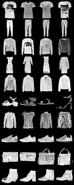
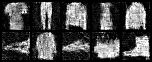
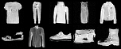

# Homework 1: Zachary Wallace (GoldenJacket)

| Part | Result |
|---|---|
| **2 · CLEF RAG** | On 120 held-out questions, my retriever raises MRR@6 from 0.270 to 0.589 and nDCG@6 from 0.373 to 0.627 (both p < 0.0001), and Eric's pilot questions still retrieve everything they did before. |
| **1 · fashion-fm** | I trained 25 epochs on PACE ICE (job 6366980, NVIDIA A40, 8 min 17 s) and again on my Mac as a check. Both reach 98.8% condition accuracy on the starter's evaluator, against 96.9% for the provided `fashion-fm-best.pt`, with no copies of training images. |

I left the starter code under `homework-1/` untouched; everything in this folder imports it.

---

## Part 2: CLEF RAG

### How I Know My RAG Is Better

When I ran the starter's retrieval evaluation, I realized it could not answer that question for me. It scored a perfect 1.0 on every metric (12 of 12 questions, Hit@1, MRR, and nDCG@3 all at 1.0), and a perfect score leaves no room to show an improvement. Most of the pilot questions name their paper, the answer is usually on page 1, and the retriever always puts the top paper's first page in slot 1. In short, it scores 1.0 no matter how good the search underneath is. Grading the system this way is like judging my putting on two-foot putts; every one drops, so it tells me nothing about my stroke.

So I built a harder test set (`make_testset.py`, saved in `eval/testset.json`). I pulled passages from page 2 onward, taking turns across all 16 CLEF labs and using at most one passage per paper, and I skipped reference lists and bare tables. For each passage, the allowed `gemma3:12b` model wrote one question that the passage answers on its own, without naming the paper, the team, or the authors; a filter caught 7 that named the paper anyway, and I threw those out. Each question has exactly one right answer: the page it came from. That gave me 233 questions, which I split into a dev set (113) for every decision I made and a test set (120) that I only used to report the final numbers.

I scored everything with the starter's own metric code (`clef_rag.metrics`), unchanged, so my numbers mean the same thing as Eric's. The two I care about most are MRR@6 and nDCG@6. A RAG answer can only cite what lands in its 6 passages, and these two reward putting the right one near the top. I also report Hit@6, and a paper-level hit that asks whether the right paper showed up at all. For every comparison I ran a paired randomization test, which asks how often a difference this large would show up by chance.

Before trusting any of it, I made sure my baseline really was the baseline. To test dozens of settings quickly, `engine.py` rebuilds the starter's retriever from the stored vectors. I checked it against the starter's real retriever on 52 questions, and the results matched on all 52.

My process was simple: change one thing at a time on dev, combine what worked on dev, run test once, and use Eric's pilot questions to make sure nothing broke.

### What I Found

**The vector database was quietly missing neighbors.** This was the result I did not expect. I had been treating Chroma as a solved component, but when I compared its search against an exact search over the same vectors (`results/ann_recall.json`), it returned only 79% of the true 20 closest passages on average. 32 of the 233 questions got less than half, and one got none of them (an average similarity of 0.389, where exact search found passages at 0.523). Chroma uses an approximate search called HNSW, which trades accuracy for speed, and it misses this much even with its search effort already set to 100. With only 21,046 passages, exact search is a single matrix product; it takes a few milliseconds and gives the same answer every time, while the HNSW baseline moved by about one question between identical runs.

**The automatic first page was taking slot 1 away from the evidence.** The starter always puts the top paper's opening passage at rank 1. For any question answered past page 1, that slot is wasted, which is why the baseline's Hit@1 is 0.000 on my test set. It is like pulling driver on every tee, par 3s included; it is the right club sometimes, but it costs you on every other hole. My first fix dropped that passage unless a paper was named. It worked on my test set but cost 2 of the 12 pilot questions; both were overview questions ("What does MultiClinSum-2 cover?") whose answer sits in the abstract. With that, I settled on a better fix: keep the opening passage, but move it to the last of the 6 slots. Named papers keep the starter's behavior, overview questions still get their abstract, and slot 1 goes to the best match.

**Several ideas did not help** (dev set, MRR@6; the baseline is 0.313):

| What I tried | MRR@6 | nDCG@6 | Hit@6 | What I take from it |
|---|---|---|---|---|
| Embeddings only | 0.197 | 0.264 | 0.460 | On their own, the embeddings are weak here. |
| Keyword search (BM25) only | 0.329 | 0.443 | 0.779 | Keyword matching does most of the work (see Limitations). |
| Weight the merge 0.7 embeddings / 0.3 keywords | 0.251 | 0.335 | 0.584 | Worse. |
| Weight the merge 0.3 embeddings / 0.7 keywords | 0.340 | 0.457 | 0.805 | Helped on dev but did not hold up on test (−0.025 Hit@6 once combined), so I dropped it. |
| 50 or 100 candidates from each search | 0.306 / 0.297 | 0.412 / 0.403 | 0.726 / 0.717 | More candidates hurt; the extras were mostly noise, and they pushed good passages down when the two lists were merged. |
| Merge constant c = 20 | 0.313 | 0.430 | 0.779 | No change. |
| Shorter embeddings: 512 / 256 / 128 dimensions | 0.340 / 0.328 / 0.309 | 0.454 / 0.436 / 0.425 | 0.788 / 0.752 / 0.770 | 512 holds up at two thirds of the index size; below that, quality drops. |
| gemma3:12b reranking the top 12 (on my best combination) | 0.602 vs 0.667 | 0.644 vs 0.708 | 0.770 vs 0.832 | It made things worse and added about 12 seconds per question. |

The reranking result was the most thought-provoking one for me. A 12 billion parameter model reading the passages did worse than two simple ranked lists merged together; it pushed correct passages out of the top 6. That goes against the common advice to add a reranker, and it is the kind of result I would want to dig into before trusting a reranker on this corpus.

### Final Results

My improved system makes only the two changes above: exact search, and the opening passage in the last slot. Everything else is the starter's (keyword plus embedding search, merged 0.5/0.5 with c = 60, 20 candidates each). The settings are in `results/best_config.json`.

**Test set (120 held-out questions)**

| System | Hit@1 | Hit@6 | MRR@6 | nDCG@6 | Paper hit@6 |
|---|---|---|---|---|---|
| Baseline (starter) | 0.000 | 0.683 | 0.270 | 0.373 | 0.783 |
| Exact search only | 0.000 | 0.742 | 0.314 | 0.422 | 0.833 |
| Opening passage last only | 0.367 | 0.683 | 0.488 | 0.537 | 0.783 |
| **Improved (both)** | **0.500** | **0.742** | **0.589** | **0.627** | **0.833** |

MRR@6 more than doubles. Against the baseline, the gains in MRR@6 and nDCG@6 are significant (p < 0.0001), and so is Hit@6 (p = 0.016); each change is also significant on its own. Question by question, 87 improved, 1 got worse, and 32 stayed the same.

Eric's pilot questions still pass. Hit@6, Recall@6, and the paper-level hit all stay at 1.000. MRR@6 drops from 1.000 to 0.867 (p = 0.50, not significant) because the two overview questions now find their page 1 answer in slot 6 instead of slot 1.

The dev numbers are in `results/dev_results.json`, and every question's result is in `results/*_results.json`.

### My Own CLEF Questions

I focused on biomedical question answering (BioASQ), plus clinical summarization, medical image questions, eRisk, and CheckThat!. I ran all 10 questions through the starter's full answer pipeline and swapped only the retriever, so any difference comes from retrieval. The full answers are in `results/my_questions_answers.json`.

For the broad questions that span many papers (BioASQ pipelines, clinical summarization, eRisk, and common failure cases), both systems pulled nearly the same passages; mine just put the specific evidence first and the abstract last, and the answers came out about equally good. My change matters most on specific detail questions, which is exactly what my test set measures.

When I asked whether reranking helped BioASQ teams, my system's answer was richer, citing three results instead of two from one team, so I checked each one against the PDFs. The BioXR-BGE and BioXR-GTE reranking result (paper40, p. 4) is correct. The Chaturvedula cross-encoder result is real, but it comes from paper23's related work, not a 2026 team. The claim of "+0.05 MRR from reranking" (paper45, p. 20) is wrong; that gain came from switching to ranked lists of answers. The right page was retrieved, but the answer model misread it, and the starter's citation check did not catch it.

On how CheckThat! teams verified numerical claims, my answer stayed on the method (reasoning traces scored by a verifier, which I confirmed on paper52, p. 2), while the baseline's second claim drifted into the task's evaluation metrics.

Both systems failed in the same places. "Which papers fine-tuned with LoRA…" gets treated as a request for an exhaustive count and refused in both. "Which BioASQ systems used RAG…" hit the answer model's output limit with my passages while the baseline answered; that is a limit on the answer, not on retrieval.

### Limitations

The test questions lean toward keywords. The model wrote each question while looking at its passage, so the question tends to reuse the passage's words, which favors keyword search. That likely explains why embeddings alone look weak and why the keyword-heavy weighting helped on dev. The two changes I kept do not depend on that bias: exact search simply finds the true closest passages, and moving the opening passage has nothing to do with either search.

Each question has only one right page. A few questions are vague enough that another paper also answers them (a label smoothing value, for example). That adds the same noise to every system, so the absolute scores run low, but the comparisons stay fair.

I looked at the test set twice. After my first test run showed the pilot problem, I added the "opening passage last" version and ran test again. I chose it because it fixed the pilot, not because of its test score, and its test MRR (0.589) is essentially the same as the earlier version's (0.590).

My `gemma3:12b` is a newer build (`b92b2185…`) than the one in the starter's results (`f4031aab…`). The embedding model (`85462619…`) is the same, so my index matches Eric's.

### How to Run

```bash
# from homework-1/clef-rag: index the corpus (the starter's own steps)
uv sync --locked && ollama pull gemma3:12b && ollama pull embeddinggemma:300m
unzip data.zip && uv run clef-rag ingest

# from this folder (uses the starter's environment)
R="uv run --project ../../../homework-1/clef-rag python"
$R make_testset.py --n 240          # writes eval/testset.json (already committed)
$R experiments.py parity            # my rebuild vs the starter retriever
$R experiments.py ann               # HNSW recall vs exact search
$R experiments.py dev               # one change at a time on dev
$R combos.py                        # combinations + gemma rerank on dev
$R intro_check.py                   # opening passage placement (dev, pilot, test)
$R experiments.py final --best '{"name":"improved","intro":"last","dense_search":"exact"}' \
   --extra '[{"name":"exact only","dense_search":"exact"},{"name":"intro last only","intro":"last"}]'
$R improved.py ask "How did BioASQ teams generate exact answers?" --track BioASQ
$R improved.py compare questions/my_questions.json
```

| File | What it does |
|---|---|
| `engine.py` | The starter retriever rebuilt with switches; its `hnsw` mode reproduces the starter exactly |
| `experiments.py` | The baseline check, the HNSW comparison, the dev runs, and the final report with significance tests |
| `make_testset.py`, `eval/testset.json` | How I built the test set, and the 233 questions |
| `improved.py` | My retriever inside the starter's answer pipeline, plus the side-by-side comparison |
| `results/` | Every number in this README |

---

## Part 1: fashion-fm

### On PACE

I ran the training job on PACE ICE with Eric's updated `job.sbatch` and changed two things in my copy (`fashion/pace/job-25-anygpu.sbatch`). First, I raised the epochs from 1 to 25; one epoch is a quick test, not a trained model. Second, I removed the RTX 6000 requirement. My first submission (job 6366802) sat in the queue because every RTX 6000 was busy while other GPUs had room, so I resubmitted asking for any GPU; it started right away, and I cancelled the first one. A model this small does not care which GPU it gets.

Job 6366980 ran on an NVIDIA A40 and finished in 8 minutes and 17 seconds with no errors, and that includes installing PyTorch. Training itself averaged 14.7 seconds an epoch, and the loss fell from 0.53 to 0.2224 (`fashion/figures/training_metrics_pace.png`). The trimmed Slurm log, the config, and the training metrics are in `fashion/pace/`.

### On My Mac

I also trained the same setup on my Mac (Apple M4 Pro, 48 GB) as a check. The starter's setup only installs on NVIDIA machines, so I built a separate environment in `fashion/.venv` for the Mac's GPU and installed the starter code into it unchanged. It took about 40 minutes, averaging 95 seconds an epoch; the early epochs were slower because the GPU was also building the RAG index, and later ones settled near 61 seconds. It ended at nearly the same loss, 0.2229.

### Evaluation

`fashion/evaluate.py` runs the starter's own evaluator on all three models, so they all face the same judge: one independent classifier (90.0% accurate on real FashionMNIST images), the same random seed, 16 samples per class, 40 steps, and guidance 2.0.

| Model | Condition accuracy | Mean target prob. | Within-class diversity | Mean distance to nearest training image | Exact copies |
|---|---|---|---|---|---|
| **Mine on PACE** (25 epochs, A40) | **98.8%** (158/160) | 0.962 | 0.355 | 0.077 | 0 |
| Mine on Mac (25 epochs) | 98.8% (158/160) | 0.957 | 0.357 | 0.079 | 0 |
| Provided `fashion-fm-best.pt` | 96.9% (155/160) | 0.927 | 0.327 | 0.104 | 0 |

The PACE and Mac runs land on the same numbers; same swing, different course. That tells me the result comes from the training recipe and not the hardware. Against the provided model, mine is comparable, since three samples out of 160 is not a meaningful difference. Mine is a bit more varied within each class and sits a bit closer to the training images, with no copies. The samples also score higher than the classifier does on real images, which tells me they are clean, typical examples of each class rather than odd ones.

| All ten classes (Mac run) | Epoch 1 → epoch 25 (Mac) | Epoch 25 (PACE) |
|---|---|---|
|  |   |  |

### How to Run

On PACE ICE (after `ssh <gt-username>@login-ice.pace.gatech.edu` on the GT VPN, with `uv` in `~/.local/bin`):

```bash
cd homework-1/fashion-fm
sed "s|^  epochs: 1$|  epochs: 25|" configs/train.yml > configs/train-25.yml
cp ../../user/GoldenJacket/homework-1/fashion/pace/job-25-anygpu.sbatch .
mkdir -p logs && sbatch job-25-anygpu.sbatch
squeue -u $USER
```

On a Mac:

```bash
cd fashion
uv venv --python 3.13 .venv
uv pip install --python .venv/bin/python "torch>=2.10,<2.11" "torchvision>=0.25,<0.26" "diffusers[torch]>=0.37" click matplotlib numpy pillow pydantic pyyaml rich tqdm
uv pip install --python .venv/bin/python --no-deps -e ../../../../homework-1/fashion-fm
.venv/bin/fashion-fm train --config train.yml
.venv/bin/fashion-fm generate --checkpoint outputs/fashion-fm/latest.pt
.venv/bin/python evaluate.py      # scores Mac, PACE (fashion/pace/latest.pt), and the provided checkpoint
```

The data, the environments, and the model weights are git-ignored, as `user/README.md` asks.
