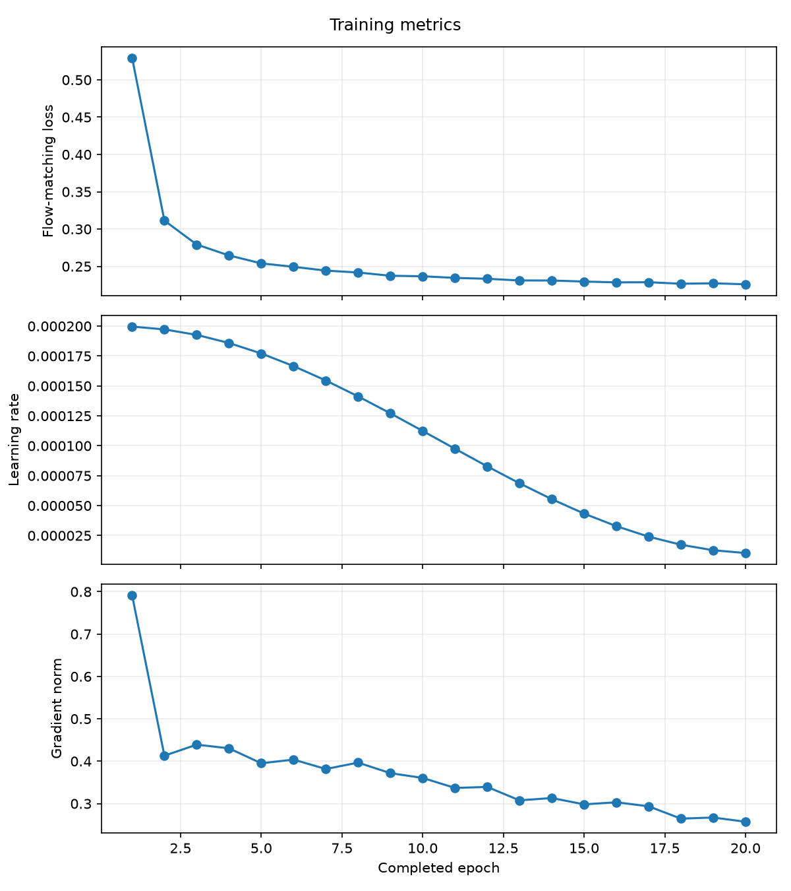

# Homework 1 Wade Sultan

## Changes

## Results

## Evaluation

## How to run

Requires the starter setup in `homework-1/clef-rag` (models pulled, `clef-rag ingest` done).

```sh
./run.sh              # every config in configs.toml
./run.sh baseline     # just the named configs
```

Experiments are defined in `configs.toml`: `[defaults]` is the starter system, and
each `[configs.<name>]` table overrides only the settings it changes. Each run writes
`results/<name>.json` and regenerates the comparison tables in `results/summary.md`.

To check the same configs against five common RAG failure modes (chunking, embedding
mismatch, retrieval noise, context overflow, hallucination):

```sh
./evaluate.sh                               # retrieval checks, every config (about a minute each)
./evaluate.sh baseline --generate           # also answer-generation checks (slow, uses the chat model)
./evaluate.sh baseline --generate --only paper-4,unsupported-2
```

Results go to `results/diagnostics/` and `results/diagnostics.md`. Questions can carry two
optional fields: `gold_quotes` (exact answer passages, to test chunking) and `paraphrases`
(rewordings, to test embedding robustness).

### Embedding-mismatch strategies

`strategies.py` adds five strategies as retriever settings, so each is one config in
`configs.toml` and both scripts above measure it:

| Setting | Strategy |
| --- | --- |
| `expand_query = true` | Append titles for `paperN` mentions; expand acronyms with a glossary mined from the corpus |
| `query_mode = "multi_query"` | Search the question plus `rewrites` gemma3 rewordings, fused with RRF |
| `query_mode = "hyde"` | Dense search on a gemma3-written hypothetical answer (HyDE) |
| `doc2query_weight > 0` | Also match questions gemma3 generated from each paper's opening page |
| `rerank_depth > 0` | gemma3 reorders the top fused candidates |

doc2query needs a one-time build (one gemma3 call per paper, about 30 minutes on an RTX 3090;
it resumes if interrupted):

```sh
./doc2query.sh            # all papers; ./doc2query.sh --limit 5 for a quick test
```

gemma3 outputs are cached under `cache/` (not committed), so reruns on the same machine are fast
and return the same results.
With every strategy off, the retriever reproduces the starter's rankings exactly.

## Part 2: fashion-fm

I trained the starter's fashion-fm model (text-conditioned flow matching on FashionMNIST)
without code changes. [fashion-fm/train.yml](fashion-fm/train.yml) is the starter config with
two changes: `epochs` goes from 1 to 20, and `data_dir` points at the starter's downloaded
dataset.

On an RTX 3090, 20 epochs took 4.4 minutes (about 13 seconds each).

| Epoch | Loss | Gradient norm |
| ---: | ---: | ---: |
| 1 | 0.529 | 0.79 |
| 2 | 0.311 | 0.41 |
| 5 | 0.254 | 0.40 |
| 10 | 0.237 | 0.36 |
| 20 | 0.226 | 0.26 |

Most of the loss drop happens in the first two epochs, and the curve is nearly flat after
epoch 10, so more epochs would likely add little. The gradient norm falls steadily with no
spikes.



Four images for each of the prompts "a plain t-shirt", "a sneaker", "small handbag" and
"ankle boot", one row per prompt. All four prompts produce recognizable items:


`fashion-fm/outputs/fashion-fm/` also has a ten-class sample grid for every epoch
(`samples-0001.png` to `samples-0020.png`) and the per-epoch numbers in `train_metrics.csv`.
Model checkpoints are not committed.

To reproduce, set up the starter's environment (`uv sync` in `homework-1/fashion-fm`), then
from `fashion-fm/` in this folder:

```sh
uv run --project ../../../../homework-1/fashion-fm fashion-fm train --config train.yml
uv run --project ../../../../homework-1/fashion-fm fashion-fm generate \
  --prompt "a plain t-shirt" --prompt "a sneaker" --prompt "small handbag" --prompt "ankle boot"
```

Training resumes from `outputs/fashion-fm/latest.pt` if it exists, so delete `outputs/` to
start over.
