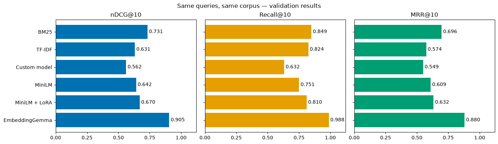

# Homework 2

## Part 1

Run all the cells in teaching.ipynb and discuss the questions at the bottom of the notebook.

### Discussion

1. Which method would you choose for finding one good result? For recovering all known evidence? Does LoRA improve all three metrics? What extra information about latency, memory, and training cost would change your choice?

#### Results
| Method         | nDCG@10 | Recall@10 | MRR@10 |
|----------------|---------|-----------|--------|
| BM25           | 0.731   | 0.849     | 0.696  |
| TF-IDF         | 0.631   | 0.824     | 0.574  |
| Custom model   | 0.562   | 0.632     | 0.549  |
| MiniLM         | 0.642   | 0.751     | 0.609  |
| MiniLM + LoRA  | 0.670   | 0.810     | 0.632  |
| EmbeddingGemma | 0.905   | 0.988     | 0.880  |

#### Which method would you choose for finding one good result?

For finding one good result, EmbeddingGemma should be chosen. 
This is because EmbeddingGemma achieved the highest nDCG@10, Recall@10, and MRR@10 compared to the rest of the methods.
Specifically, EmbeddingGemma achieved a much higher MRR@10 compared to all other methods (0.880 vs the next best result of 0.696). 
Since MRR@10 measures how soon a retriever finds the first relevant document, the higher MRR@10 score means the method that will most likely find one good result.

#### For recovering all known evidence?

For recovering all known evidence, EmbeddingGemma should again be chosen. 
Recovering all known evidence is a recall task and EmbeddingGemma achieved the highest Recall@10 of about 0.988. 
This means that EmbeddingGemma already retrieved about 99% of the relevant documents within the top 10 results.

#### Does LoRA improve all three metrics?

Yes, LoRA improved all three metrics as shown in the table below:

| Method         | nDCG@10 | Recall@10 | MRR@10 |
|----------------|---------|-----------|--------|
| MiniLM         | 0.642   | 0.751     | 0.609  |
| MiniLM + LoRA  | 0.670   | 0.810     | 0.632  |

#### What extra information about latency, memory, and training cost would change your choice?

If latency, memory, and training cost are concerns, then BM25 is a strong alternative because it ranked second across all three metrics behind EmbeddingGemma. Lexical retrieval works well in scenarios requiring exact rare terms, such as in scientific topics. However it is also important to note that lexical retrieval struggles when relevant documents use synonyms or paraphrases instead of shared words.

Below compares BM25 to EmbeddingGemma in terms of latency, memory, and training cost:

- Latency: At query time, BM25 only requires tokenizing and scoring via an inverted index, which runs fast on a CPU. EmbeddingGemma must encode every incoming query through its ~300M-parameter model before searching, and its latency increases noticeably without GPU acceleration.

- Memory: BM25 uses low memory since it only stores sparse term statistics and inverted index. EmbeddingGemma requires much more memory to hold its model weights along with dense vector storage.

- Training cost: BM25 requires no training, only computing term frequencies and corpus statistics. EmbeddingGemma also requires no training here because its pretrained weights were frozen. However, unfreezing or adapting dense retrieval weights (such as MiniLM + LoRA) incurs training cost.

---

These checkpoints were selected using this validation set, and results come from one training run. Public pretraining overlap with SciFact cannot be ruled out. Freeze choices before using the official test set for a final evaluation.

### Responses

**Add your responses to the questions above in this file and submit a PR.**