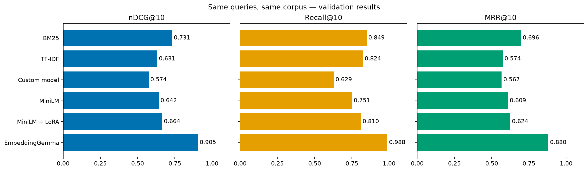

# Homework 2 — Juni Nguyen

## What I did

I ran the notebook `homework_2/text_ir/teaching.ipynb` from top to bottom on my Mac,
using the default settings. The full notebook with all outputs is in
[`teaching.ipynb`](teaching.ipynb).

**The task:** given a scientific claim, find the research abstracts that are evidence
for it. Six search methods were tested on the same data:

- **5,183** abstracts to search through
- **647** claims used for training
- **162** claims used for testing (the validation set)

**The six methods:**

| Method | How it works |
|---|---|
| BM25 | Word matching. Rare words count more. |
| TF-IDF | A simpler kind of word matching. |
| Custom model | A small neural network trained from scratch on our 647 claims. |
| MiniLM | A small pretrained neural model, used as-is. |
| MiniLM + LoRA | MiniLM with a small add-on trained on our claims. |
| EmbeddingGemma | A large pretrained neural model, used as-is. |

## How results are scored

Each method returns its top 10 abstracts for every claim. All scores go from 0 to 1,
and higher is better.

- **MRR@10:** How high is the *first* correct abstract? 1.0 means it's always ranked #1.
- **Recall@10:** What share of *all* the correct abstracts made the top 10?
- **nDCG@10:** An overall score. It rewards finding correct abstracts *and* ranking
  them near the top.

## Results

| Method | nDCG@10 | Recall@10 | MRR@10 |
|---|---|---|---|
| BM25 | 0.731 | 0.849 | 0.696 |
| TF-IDF | 0.631 | 0.824 | 0.574 |
| Custom model | 0.574 | 0.629 | 0.567 |
| MiniLM | 0.642 | 0.751 | 0.609 |
| MiniLM + LoRA | 0.664 | 0.810 | 0.624 |
| EmbeddingGemma | **0.905** | **0.988** | **0.880** |

**In short:** EmbeddingGemma is clearly the best. Plain word matching (BM25) comes
second and beats every model we trained ourselves.

## Discussion

### Question 1

**Which method is best for finding one good result?**
EmbeddingGemma. It has the highest MRR (0.880), so the first correct abstract is
usually ranked #1. Without a large neural model, BM25 is the next best choice (0.696).

**Which method is best for finding all the evidence?**
EmbeddingGemma again. Its Recall is 0.988, so almost every correct abstract shows up
in its top 10. BM25 is second (0.849).

**Does LoRA improve all three scores?**
Yes, but only a little:

| | MiniLM | MiniLM + LoRA | Change |
|---|---|---|---|
| nDCG@10 | 0.642 | 0.664 | +0.022 |
| Recall@10 | 0.751 | 0.810 | +0.060 |
| MRR@10 | 0.609 | 0.624 | +0.015 |

The biggest gain is in Recall. LoRA helped the model put *more* correct abstracts in
the top 10, but it didn't do much to move the first one higher. Even with LoRA,
MiniLM is still worse than BM25 on all three scores.

**Other things I noticed:**
- **BM25 beats TF-IDF** on every score. BM25 handles long abstracts and repeated
  words better.
- **The custom model is last.** It started from nothing and only had 647 claims to
  learn from. It memorized the training data: its training loss dropped from 2.89
  to 0.03, but its test score stopped improving at about 0.57.
- **Pretraining matters most.** The jump from the custom model to MiniLM, and from
  MiniLM to Gemma, is much bigger than what LoRA adds.

**What would change my choice: speed, memory, and training cost**

| | BM25 | MiniLM + LoRA | EmbeddingGemma |
|---|---|---|---|
| Model size | No model | 22.8M parameters (LoRA trains only 73,728 of them, 0.32%) | About 300M parameters, about 1.2 GB |
| Time to process all abstracts | Seconds | Fast | 6 min 16 s on my Mac |
| Needs a GPU? | No | Helps | Strongly recommended |
| Training needed? | No | Yes, 20 epochs | No |

*MiniLM's size and Gemma's processing time come from my notebook output. Gemma's size
comes from its model card.*

- **If speed, memory, or cost matter most,** I would pick **BM25**. In this test it
  was both cheaper *and* more accurate than MiniLM + LoRA, so training LoRA wasn't
  worth it here.
- **If accuracy matters most,** I would pick **EmbeddingGemma**. It is much better
  than BM25 (about +0.17 nDCG and +0.18 MRR), and the abstracts only need to be
  processed once.
- **A good middle option:** use BM25 to quickly pick a shortlist, then let Gemma
  re-rank only that shortlist. This would be my next experiment.

### Question 2: Limits of these results

- **The scores for the trained models are a bit too optimistic.** For the custom
  model and LoRA, we kept the training round that scored best on the same claims we
  report here.
- **Each model was trained only once.** Small differences, like LoRA's +0.015 MRR,
  could be due to chance.
- **The pretrained models may have seen this data before.** SciFact is a public
  dataset, so MiniLM or Gemma may have trained on it. That could explain some of
  Gemma's near-perfect recall.
- **Some correct abstracts may be unlabeled.** Any abstract that wasn't labeled as
  correct counts as wrong, even if it is actually useful evidence.
- **Next step:** Decide on the final model and settings first. Then test it once on the official test set, which these models have never seen, to get a fair final score.

## Acknowledgments
 
I used Claude (Anthropic's AI assistant, model Claude Opus 5.5) to explain technical
terms in plain language (for example nDCG, MRR, Recall, LoRA, and validation vs. test
sets), and to help draft and simplify the wording of this README. I ran the notebook
myself, and all results come from my own run.